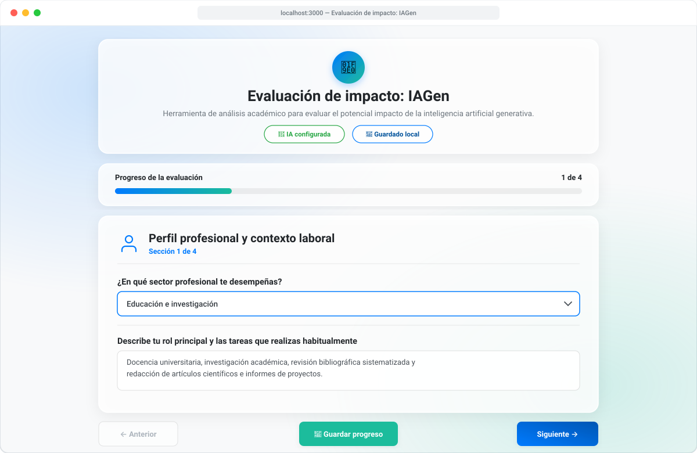
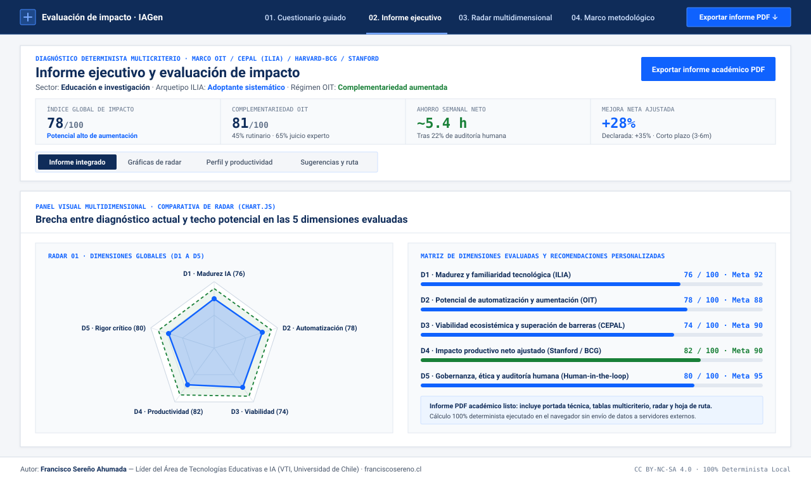

# Evaluación de impacto: IAGen en el día a día

[](./package.json)
[](#motor-heurístico-y-determinista)
[%20%C2%B7%20BCG%20%C2%B7%20Stanford-0043CE?style=for-the-badge)](#propósito-y-marco-teórico-de-referencia)
[](#sistema-de-diseño-y-experiencia-de-usuario-uxui)
[](https://www.typescriptlang.org/)
[](https://vitejs.dev/)
[](https://www.gnu.org/licenses/gpl-3.0)
[](https://creativecommons.org/licenses/by-nc/4.0/)
[](https://www.linkedin.com/in/franciscosereno)

Instrumento interactivo de análisis académico, institucional y profesional diseñado para diagnosticar, proyectar y evaluar de manera crítica el impacto de la **inteligencia artificial generativa (IAGen)** en el quehacer laboral cotidiano.

La aplicación combina un cuestionario estructurado en **4 módulos (13 criterios de evaluación)** con un **Inspector diagnóstico en vivo** provisto de *tooltips* metodológicos y un **motor multicriterio heurístico y determinista** que se ejecuta íntegramente en el navegador del usuario (sin llamadas a modelos externos, sin claves de API y sin telemetría de terceros). Genera un **panel visual (*dashboard*) con gráficas de radar comparativas en Chart.js**, detección algorítmica de sobrestimaciones o subestimaciones productivas y un **informe técnico-académico descargable en formato PDF**.

---

## Capturas de pantalla de la aplicación

### 1. Espacio de trabajo guiado e Inspector diagnóstico en vivo con *tooltips* OIT / CEPAL


### 2. Informe ejecutivo, indicadores empíricos y panel de radar multidimensional


---

## Propósito y marco teórico de referencia

La adopción de herramientas de inteligencia artificial generativa suele estar acompañada tanto de expectativas desmedidas de velocidad como de fricciones institucionales, éticas o de gobernanza de datos. Este instrumento operacionaliza en un algoritmo determinista cuatro marcos empíricos internacionales (2025–2026):

1. **Organización Internacional del Trabajo (OIT / ILO, 2025)** — *Generative AI and Jobs: A Global Analysis of Potential Effects on Job Quantity and Quality*: diferencia ocupaciones con potencial de **aumentación y complementariedad humana** frente a aquellas sujetas a transformación o automatización rutinaria según su gradiente de exposición.
2. **CEPAL y CENIA (2024–2025)** — *Índice Latinoamericano de Inteligencia Artificial (ILIA)* y *Transformación digital y empleo en América Latina*: clasifica la madurez de adopción en tres arquetipos (**Explorador inicial**, **Adoptante sistemático** y **Pionero en gobernanza e integración**), incorporando el análisis de brechas de infraestructura, gobernanza y la **curva J de adopción tecnológica**.
3. **Harvard Business School, MIT Sloan y Boston Consulting Group (Dell'Acqua et al.)** — *Navigating the Jagged Technological Frontier*: modela el riesgo de la **«Frontera Tecnológica Irregular»** (*Jagged Frontier*) y el efecto de **compresión de habilidades** (*Skill Compression*), descontando la sobrecarga obligatoria de auditoría humana (*Human-in-the-loop*) necesaria para verificar alucinaciones y sesgos.
4. **Stanford HAI AI Index Report y McKinsey Global Institute (2025)**: calibra los techos empíricos sectoriales de mejora productiva neta y las horas semanales efectivamente recuperables según la intensidad de trabajo documental y analítico.

---

## Inspector diagnóstico en vivo y *tooltips* metodológicos

El panel lateral derecho (**Inspector diagnóstico en vivo**) recalcula en tiempo real las métricas de la sesión a medida que el usuario responde cada criterio. Al pasar el cursor (*hover*) o enfocar con el teclado (`Tab`) cualquiera de los **9 indicadores**, se despliega un *tooltip* accesible (`role="tooltip"`) con su fundamento teórico:

| Indicador en el Inspector | Marco de referencia | Significado metodológico en el modelo determinista |
| :--- | :--- | :--- |
| **Sector profesional** | Clasificación OIT / CEPAL | Define el gradiente de exposición ocupacional, el techo empírico de productividad y la frontera tecnológica sectorial. |
| **Nivel de experiencia** | Madurez ILIA (CEPAL/CENIA) | Calibra el efecto nivelador de habilidades (*Skill Compression*) y la capacidad de juicio experto para auditar alucinaciones. |
| **Carga rutinaria / crítica** | Gradiente de exposición OIT | Proporción entre tareas codificables (automatizables) y funciones analíticas o creativas de alto contexto humano (aumentación). |
| **Herramientas / barreras** | Viabilidad ecosistémica CEPAL | Contrasta la amplitud del ecosistema tecnológico seleccionado (LLM, RAG, flujos agénticos) con las fricciones institucionales o éticas. |
| **Horizonte estimado** | Curva J de adopción (CEPAL) | Plazo previsto para superar la curva de aprendizaje inicial, rediseñar procesos y estabilizar el retorno operativo. |
| **Expectativa declarada** | Contraste empírico OIT / BCG | Ganancia bruta percibida por el usuario antes de contrastarla con el techo sectorial y descontar la auditoría humana. |
| **Estado del modelo** | Índice heurístico (OIT / CEPAL) | Puntaje compuesto (`0–100`) que sintetiza exposición rutinaria, madurez de adopción, herramientas y fricciones operativas. |
| **Rango realista** | OIT · Stanford AI Index | Intervalo empírico de mejora neta de productividad observado en estudios de campo para el sector seleccionado. |
| **Auditoría humana** | Frontera Irregular · BCG | Porcentaje estimado del tiempo ahorrado que debe reinvertirse en verificación experta (*Human-in-the-loop*) y control de calidad. |

---

## Características principales

### 1. Diagnóstico estructurado en 4 módulos y 13 criterios
- **Módulo 01 · Perfil profesional y contexto laboral**: sector de desempeño (8 sectores calibrados empíricamente), descripción funcional del cargo y nivel actual de familiaridad con herramientas de IAGen.
- **Módulo 02 · Análisis de tareas y procesos**: composición porcentual de tareas rutinarias frente a creativas/críticas, horas semanales dedicadas a producción documental y cuellos de botella operativos.
- **Módulo 03 · Escenarios de implementación de IAGen**: selección de herramientas (asistentes conversacionales, búsqueda con anclaje documental RAG, análisis de datos, generación multimodal, código y flujos agénticos multipaso), barreras percibidas y horizonte temporal de adopción.
- **Módulo 04 · Proyección de impactos y brechas**: expectativa porcentual de mejora productiva, áreas de impacto positivo, preocupaciones éticas o laborales y competencias clave por desarrollar.

### 2. Motor heurístico y determinista (100 % local y sin IA externa)
- **Cálculo reproducible y auditable**: ante las mismas entradas, el modelo produce exactamente el mismo diagnóstico numérico y cualitativo sin depender de llamadas a APIs externas.
- **Evaluación en 5 dimensiones (`0–100`)**:
  - `D1 · Madurez IA`: familiaridad técnica y amplitud del repertorio de herramientas seleccionadas.
  - `D2 · Automatización`: exposición de tareas rutinarias e intensidad de redacción documental.
  - `D3 · Viabilidad`: factibilidad operativa ponderada por el horizonte temporal y las barreras institucionales.
  - `D4 · Productividad`: impacto productivo neto ajustado al techo empírico del sector tras descontar la auditoría humana.
  - `D5 · Rigor crítico`: gobernanza, conciencia de riesgos éticos, verificación experta y plan de recapacitación.
- **Detección matemática de brechas de expectativa**: identifica automáticamente si la expectativa declarada por el usuario constituye una **sobrestimación** (riesgo de complacencia en la Frontera Irregular), una **subestimación** (oportunidad latente no capturada) o una **estimación alineada** con la evidencia empírica de su sector.

### 3. Panel visual (*Dashboard*) con gráficas de radar en Chart.js
- **Radar 01 · Dimensiones globales (`D1` a `D5`)**: superpone el polígono del diagnóstico actual (`#0F62FE`) frente al techo potencial alcanzable (`#198038`) en el sector del usuario.
- **Radar 02 · Capacidades operativas (6 ejes)**: compara el perfil actual frente a la meta proyectada en *Automatización documental*, *Sistemas RAG*, *Datos y flujos agénticos*, *Factores habilitantes*, *Gobernanza y ética* e *Ingeniería de contexto*.
- **Gráficos complementarios y filtros interactivos**: visualización de la composición de la jornada laboral, severidad de barreras y controles segmentados para alternar entre el *Informe integrado*, *Gráficas de radar*, *Perfil y productividad* y *Sugerencias y hoja de ruta*.

### 4. Exportación a PDF con formato académico profesional
Generación instantánea en cliente mediante **jsPDF** y **jsPDF-AutoTable** de un documento multipágina listo para archivo institucional o discusión académica:
- **Portada académica estructurada**: encabezado institucional, ficha técnica del participante, arquetipo ILIA, régimen OIT, tabla resumen de las 5 dimensiones (`D1`–`D5`) y síntesis ejecutiva.
- **Tablas de resultados y contraste internacional**: registro íntegro de las 13 variables capturadas y tabla comparativa de indicadores empíricos (complementariedad OIT, compresión de habilidades, riesgo de frontera irregular y ahorro semanal neto en horas).
- **Integración visual de alta resolución**: incrustación directa del lienzo de las gráficas de radar generadas en el panel visual.
- **Matriz personalizada de sugerencias y hoja de ruta en 3 fases**: recomendaciones parametrizadas según las herramientas, barreras y horizonte declarados, acompañadas de las referencias bibliográficas del marco teórico.

---

## Sistema de diseño y experiencia de usuario (UX/UI)

- **Tipografía editorial y científica**:
  - **IBM Plex Sans** (`400`, `500`, `600`, `700`) para jerarquía editorial, formularios de alta legibilidad y tablas analíticas.
  - **IBM Plex Mono** (`tabular-nums`) para índices numéricos, códigos de criterio (`01.1` a `04.4`), porcentajes y telemetría en vivo.
- **Paleta cromática institucional**:
  - **Azul Cobalto Institucional (`#0F2C59`)** en la barra superior de navegación y controles activos de visualización.
  - **Azul Celeste Institucional (`#EDF5FF` / `#D0E2FF`)** en el encabezado del *Inspector diagnóstico en vivo* y paneles de referencia empírica.
  - **Azul IBM (`#0F62FE`)** y **Verde Esmeralda (`#198038`)** para contrastar diagnóstico actual frente a potencial objetivo.
- **Persistencia y portabilidad de sesión**:
  - Autoguardado reactivo en `localStorage` para evitar pérdida de datos al recargar el navegador.
  - Exportación e importación de sesiones completas en formato `.json` para análisis comparativo o respaldo local.

---

## Estructura del proyecto

```text
├── public/
│   ├── screenshot.svg           # Captura del espacio de trabajo e Inspector con tooltips OIT/CEPAL
│   └── screenshot-dashboard.svg # Captura del informe ejecutivo y panel de gráficas de radar
├── index.html                   # Arquitectura HTML5, barra institucional, modales y estructura de 12 columnas
├── index.tsx                    # Motor heurístico determinista, tooltips OIT/CEPAL, gráficas Chart.js y PDF
├── index.css                    # Estilos globales con Tailwind CSS v4, IBM Plex Sans/Mono y tooltips accesibles
├── config.js                    # Parámetros generales y utilidades de validación de entorno
├── vite.config.ts               # Configuración del servidor de desarrollo y empaquetado con Vite
├── package.json                 # Dependencias del proyecto y scripts de construcción
├── tsconfig.json                # Configuración estricta del compilador TypeScript
└── metadata.json                # Metadatos descriptivos de la aplicación
```

---

## Requisitos e instalación local

### Requisitos previos
- **Node.js** 18.x o superior.
- **npm** 9.x o superior.
- No requiere claves de API (`API keys`), cuentas externas ni conexión a servidores de inteligencia artificial.

### Ejecución en entorno local

1. **Clonar el repositorio**:
   ```bash
   git clone <url-del-repositorio>
   cd <nombre-del-directorio>
   ```

2. **Instalar las dependencias**:
   ```bash
   npm install
   ```

3. **Iniciar el servidor de desarrollo**:
   ```bash
   npm run dev
   ```
   La aplicación estará disponible en `http://localhost:3000`.

4. **Generar la compilación de producción**:
   ```bash
   npm run build
   ```

---

## Tecnologías utilizadas


---

## Créditos y autoría

- **Autor**: **Francisco Sereño** — Profesor, doctor (c) en Educación y Sociedad, Universitat de Barcelona.
- **Perfil profesional**: [](https://www.linkedin.com/in/franciscosereno) (`https://www.linkedin.com/in/franciscosereno`)

---

## Licenciamiento

- **Código fuente**: distribuido bajo la licencia **GNU General Public License v3.0 (GPL-3.0)**.
- **Contenido didáctico, estructura diagnóstica y marco metodológico**: distribuido bajo la licencia **Creative Commons Atribución-NoComercial 4.0 Internacional (CC BY-NC 4.0)**.
